# Arquitetura do Projeto

## 1. Visão geral

O projeto é um Sistema de Acompanhamento de Questões com Notificações ao Vivo, desenvolvido a partir da evolução de uma API REST para gerenciamento de um Banco de Questões.

Nos Trabalhos 1 e 2 foram desenvolvidas a API REST, a persistência com PostgreSQL e Sequelize ORM, os relacionamentos, migrations, seeders, filtros, paginação e transações.

No Trabalho 3, o projeto passou por uma refatoração arquitetural para melhorar a separação de responsabilidades, reduzir o acoplamento e facilitar manutenção e testes.

No Trabalho 4, a aplicação foi ampliada com:

- frontend em React;
- comunicação em tempo real com Socket.IO;
- salas organizadas por disciplina;
- notificações persistentes;
- acompanhamento do status das questões;
- reconexão automática;
- Docker e Docker Compose;
- frontend e backend servidos pela mesma aplicação.

A arquitetura atual combina:

- Arquitetura em camadas;
- conceitos de MVC;
- Repository;
- Injeção de Dependência;
- DTO;
- comunicação REST;
- comunicação WebSocket;
- frontend React;
- persistência relacional;
- conteinerização com Docker.

---

## 2. Estrutura principal

```text
Trabalho 1 API/
│
├── config/
│   └── config.js
│
├── docs/
│   └── adr/
│       ├── 001-arquitetura-em-camadas.md
│       └── 002-injecao-de-dependencia.md
│
├── frontend/
│   ├── src/
│   │   ├── components/
│   │   │   ├── CentroNotificacoes.jsx
│   │   │   ├── EntrarSala.jsx
│   │   │   ├── ListaQuestoes.jsx
│   │   │   ├── PainelTempoReal.jsx
│   │   │   ├── ParticipantesConectados.jsx
│   │   │   └── StatusConexao.jsx
│   │   ├── services/
│   │   │   └── socket.js
│   │   └── App.jsx
│   └── package.json
│
├── migrations/
│
├── models/
│   ├── index.js
│   ├── questao.js
│   ├── disciplina.js
│   ├── categoria.js
│   ├── assunto.js
│   └── notificacao.js
│
├── seeders/
│
├── src/
│   ├── config/
│   │   └── container.js
│   │
│   ├── controllers/
│   │   ├── questoes.controller.js
│   │   ├── disciplinas.controller.js
│   │   ├── categorias.controller.js
│   │   ├── assuntos.controller.js
│   │   └── notificacoes.controller.js
│   │
│   ├── docs/
│   │   └── openapi.yaml
│   │
│   ├── dtos/
│   │   └── questao.dto.js
│   │
│   ├── middlewares/
│   │   └── erro.middleware.js
│   │
│   ├── public/
│   │
│   ├── repositories/
│   │   ├── questoes.repository.js
│   │   ├── disciplinas.repository.js
│   │   ├── categorias.repository.js
│   │   ├── assuntos.repository.js
│   │   └── notificacoes.repository.js
│   │
│   ├── routes/
│   │
│   ├── services/
│   │
│   ├── websocket/
│   │   └── socket.js
│   │
│   └── app.js
│
├── .dockerignore
├── .env.example
├── Dockerfile
├── docker-compose.yml
├── ARQUITETURA.md
├── README.md
├── package.json
└── package-lock.json
```

---

## 3. Visão geral da arquitetura

A aplicação possui dois fluxos principais.

### Fluxo REST

```text
React / Swagger / Insomnia
          ↓
        Routes
          ↓
     Controllers
          ↓
       Services
          ↓
    Repositories
          ↓
 Models / Sequelize
          ↓
      PostgreSQL
```

### Fluxo em tempo real

```text
Cliente React
     ↕
Socket.IO Client
     ↕
Socket.IO Server
     ↕
Sala da Disciplina
     ↕
Outros clientes conectados
```

As duas formas de comunicação trabalham juntas.

A API REST é responsável pela persistência e pelas operações tradicionais do sistema.

O WebSocket é responsável por enviar atualizações aos clientes imediatamente, sem necessidade de atualizar manualmente a página.

---

## 4. Diagrama geral

```mermaid
flowchart TD

    A[Frontend React] --> B[API REST]
    A <--> W[Socket.IO]

    B --> C[Routes]
    C --> D[Controllers]
    D --> E[Services]
    E --> F[Repositories]
    F --> G[Models / Sequelize]
    G --> H[(PostgreSQL)]

    D --> W

    W <--> R[Salas por Disciplina]

    I[Container de Dependências] --> E
    I --> F
```



---

## 5. Responsabilidade das camadas

### 5.1 Routes

As rotas definem os endpoints HTTP e encaminham as requisições para os controllers.

Exemplos:

```text
GET /questoes
POST /questoes
PATCH /questoes/:id

GET /disciplinas

GET /categorias

GET /assuntos

GET /notificacoes
PATCH /notificacoes/:id/marcar-como-lida
```

As rotas não implementam regras de negócio e não acessam diretamente o banco de dados.

---

### 5.2 Controllers

Os controllers são responsáveis pela comunicação HTTP.

Eles:

- recebem parâmetros da URL;
- recebem dados do body;
- recebem query parameters;
- chamam os services;
- definem códigos HTTP;
- retornam as respostas;
- encaminham erros ao middleware.

No Trabalho 4, alguns controllers também participam da integração com o sistema de eventos.

Por exemplo, depois de uma operação ser concluída com sucesso, o controller de questões pode emitir eventos Socket.IO para os clientes conectados.

Entre os eventos emitidos estão:

```text
questao_criada
questao_atualizada
questao_excluida
status_questao_alterado
notificacao_nova
```

A regra de persistência continua concentrada nas camadas de service e repository.

---

### 5.3 Services

Os services concentram regras e casos de uso da aplicação.

Entre suas responsabilidades estão:

- validar informações;
- verificar existência de registros;
- validar status das questões;
- coordenar operações;
- definir situações de erro;
- chamar repositories.

O campo `status` de uma questão aceita:

```text
rascunho
em_revisao
aprovada
```

Valores diferentes são rejeitados pela aplicação.

Existe também um service específico para as notificações persistentes.

---

### 5.4 Repositories

Os repositories concentram o acesso ao banco de dados.

Nessa camada são utilizadas operações do Sequelize como:

```text
findAll
findByPk
findAndCountAll
create
update
destroy
include
```

Também ficam nessa camada:

- filtros;
- paginação;
- busca;
- ordenação;
- relacionamentos;
- transações;
- persistência das notificações.

O objetivo é impedir que detalhes do Sequelize fiquem espalhados pela aplicação.

---

### 5.5 Models

Os models representam as entidades persistidas.

As principais entidades são:

```text
Questão
Disciplina
Categoria
Assunto
Notificação
```

Os principais relacionamentos são:

```text
Disciplina 1:N Questões

Categoria 1:N Questões

Questões N:N Assuntos

Disciplina 1:N Notificações

Questão 1:N Notificações
```

O relacionamento muitos-para-muitos entre questões e assuntos utiliza:

```text
questao_assuntos
```

---

### 5.6 DTO

O DTO organiza os dados recebidos antes que sejam enviados para a camada de serviço.

Arquivo:

```text
src/dtos/questao.dto.js
```

É utilizado principalmente nas operações:

```text
POST /questoes
PUT /questoes/:id
PATCH /questoes/:id
```

O DTO também inclui o campo `status`.

O uso do DTO evita que os controllers precisem montar manualmente os mesmos objetos em diferentes operações.

---

### 5.7 Middlewares

Os middlewares tratam responsabilidades comuns da aplicação.

O projeto possui middleware centralizado para tratamento de erros.

Entre os códigos retornados estão:

```text
400 - Dados inválidos
404 - Recurso não encontrado
409 - Conflito de integridade
500 - Erro interno
```

---

### 5.8 Container de Dependências

O arquivo:

```text
src/config/container.js
```

é responsável por montar as dependências da aplicação.

O fluxo é:

```text
Repository
    ↓
Container
    ↓
Service
```

O container também realiza a composição das dependências relacionadas às notificações.

Isso permite que um service receba a implementação que irá utilizar sem precisar instanciá-la diretamente.

---

## 6. MVC no projeto

O sistema utiliza conceitos de MVC adaptados à arquitetura em camadas.

### Model

Representado principalmente pelos arquivos da pasta:

```text
models/
```

Os models representam as entidades persistidas pelo Sequelize.

### Controller

Representado por:

```text
src/controllers/
```

Os controllers recebem requisições e acionam os casos de uso.

### View

Nos Trabalhos anteriores, a API retornava apenas respostas JSON.

No Trabalho 4 foi criado um frontend em React.

Assim, a camada visual passou a ser representada pela aplicação existente em:

```text
frontend/
```

O React consome a API REST e também recebe atualizações pelo Socket.IO.

---

## 7. Frontend React

O frontend foi criado com React e Vite.

Os principais componentes são:

```text
StatusConexao
EntrarSala
ParticipantesConectados
ListaQuestoes
PainelTempoReal
CentroNotificacoes
```

### StatusConexao

Mostra se o cliente está conectado ao servidor Socket.IO.

Também identifica situações de desconexão e reconexão.

### EntrarSala

Permite informar o usuário e a disciplina que será acompanhada.

Também mantém os dados necessários para que o cliente volte automaticamente à sala depois de uma reconexão.

### ParticipantesConectados

Mostra os participantes atualmente conectados à sala.

### ListaQuestoes

Consome a API REST.

Permite:

- listar questões;
- buscar pelo enunciado;
- filtrar por status;
- atualizar os dados quando eventos Socket.IO são recebidos.

### PainelTempoReal

Apresenta eventos recebidos pelo WebSocket.

Entre eles:

```text
questao_criada
questao_atualizada
questao_excluida
status_questao_alterado
```

### CentroNotificacoes

Apresenta as notificações armazenadas no banco.

Também recebe:

```text
notificacao_nova
```

pelo WebSocket.

O usuário pode marcar uma notificação como lida.

Esse estado é persistido no PostgreSQL.

---

## 8. Comunicação WebSocket

A comunicação em tempo real é implementada com Socket.IO.

O servidor é configurado em:

```text
src/websocket/socket.js
```

O cliente é configurado em:

```text
frontend/src/services/socket.js
```

---

## 9. Salas por disciplina

Os clientes são agrupados em salas.

O formato utilizado é:

```text
disciplina:<id>
```

Exemplo:

```text
disciplina:1
```

Assim, um evento relacionado a uma questão de determinada disciplina pode ser enviado apenas para os usuários interessados naquela disciplina.

---

## 10. Eventos recebidos pelo servidor

Entre os eventos enviados pelo cliente para o servidor estão:

```text
entrar_sala
sair_sala
```

O servidor valida os dados antes de processar a entrada.

Caso exista algum problema, pode emitir:

```text
erro_socket
```

Após a entrada ou saída, também podem ser emitidos:

```text
sala_entrada_confirmada
sala_saida_confirmada
participantes_atualizados
```

---

## 11. Eventos de negócio

Os principais eventos utilizados na aplicação são:

### questao_criada

Emitido depois que uma questão é cadastrada.

### questao_atualizada

Emitido depois que uma questão é atualizada.

### questao_excluida

Emitido depois que uma questão é removida.

### status_questao_alterado

Emitido quando ocorre mudança no status da questão.

### notificacao_nova

Emitido quando uma nova notificação persistente é criada.

Esses eventos permitem que diferentes clientes visualizem as mudanças sem precisar atualizar manualmente o navegador.

---

## 12. Fluxo de alteração de status

Um dos fluxos principais do Trabalho 4 acontece quando o status de uma questão é alterado.

Exemplo:

```text
PATCH /questoes/12
```

Body:

```json
{
  "status": "aprovada"
}
```

Fluxo simplificado:

```text
Cliente
   ↓
PATCH /questoes/12
   ↓
Route
   ↓
Controller
   ↓
DTO
   ↓
Service
   ↓
Repository
   ↓
PostgreSQL
```

Depois da atualização:

```text
Status anterior é comparado ao novo status
                  ↓
         Status foi alterado?
                  ↓
                 Sim
                  ↓
        Cria notificação persistente
                  ↓
              PostgreSQL
                  ↓
       Emite eventos Socket.IO
                  ↓
            Sala da disciplina
                  ↓
          Clientes conectados
```

São emitidos eventos como:

```text
questao_atualizada
status_questao_alterado
notificacao_nova
```

---

## 13. Notificações persistentes

As notificações não existem apenas no WebSocket.

Elas são gravadas no PostgreSQL.

Isso resolve um problema importante: eventos WebSocket são temporários, enquanto a notificação precisa continuar disponível posteriormente.

A entidade possui informações como:

```text
id
mensagem
tipo
lida
questaoId
disciplinaId
created_at
updated_at
```

O fluxo é:

```text
Mudança de estado da questão
          ↓
Criação da notificação
          ↓
Persistência no PostgreSQL
          ↓
Evento notificacao_nova
          ↓
Frontend
```

Quando o usuário marca a notificação como lida:

```text
Frontend
   ↓
PATCH /notificacoes/:id/marcar-como-lida
   ↓
API REST
   ↓
PostgreSQL
```

Assim, ao atualizar a página, a notificação continua marcada como lida.

---

## 14. Reconexão

O cliente Socket.IO está configurado para tentar reconectar automaticamente.

Fluxo:

```text
Cliente conectado
      ↓
Conexão interrompida
      ↓
Socket.IO tenta reconectar
      ↓
Conexão restabelecida
      ↓
Cliente entra novamente na sala anterior
```

Essa estratégia evita que o usuário precise atualizar a página ou informar novamente a sala depois de uma interrupção temporária.

---

## 15. Integração REST e WebSocket

REST e WebSocket possuem responsabilidades diferentes.

### REST

Usado para:

- CRUD;
- consultas;
- filtros;
- busca;
- paginação;
- atualização do status;
- leitura de notificações;
- persistência.

### WebSocket

Usado para:

- alterações em tempo real;
- participantes conectados;
- atualização imediata de questões;
- alteração de status;
- novas notificações.

A persistência não depende do WebSocket.

O WebSocket complementa a API REST, permitindo sincronização entre clientes.

---

## 16. Transações

A aplicação utiliza transações do Sequelize nas operações que envolvem questões e seus assuntos.

Exemplo:

```text
Criar questão
      +
Relacionar assuntos
      ↓
Uma única transação
```

Caso uma etapa falhe:

```text
ROLLBACK
```

evita que o banco fique com dados parcialmente gravados.

---

## 17. Filtros e paginação

A listagem de questões utiliza filtros e paginação no banco.

Exemplos:

```text
GET /questoes?page=1&limit=10

GET /questoes?dificuldade=facil

GET /questoes?status=em_revisao

GET /questoes?busca=porcentagem
```

Os filtros são tratados pelo repository, mantendo os detalhes da persistência fora dos controllers.

---

## 18. Docker

O projeto utiliza Docker para empacotar a aplicação.

O arquivo:

```text
Dockerfile
```

possui uma etapa de compilação do frontend React e uma etapa para execução da aplicação Node.js.

Fluxo:

```text
Código React
     ↓
npm run build
     ↓
frontend/dist
     ↓
copiado para src/public
     ↓
Express serve os arquivos
```

Por isso, frontend e backend ficam disponíveis pela mesma porta.

---

## 19. Docker Compose

O arquivo:

```text
docker-compose.yml
```

organiza os serviços:

```text
app
db
```

### Serviço db

Utiliza:

```text
PostgreSQL
```

Possui:

- volume persistente;
- variáveis de ambiente;
- health check.

### Serviço app

Executa:

- migrations;
- seed;
- servidor Express;
- Socket.IO;
- frontend compilado.

O serviço da aplicação depende da saúde do banco antes de iniciar.

---

## 20. Health checks

O PostgreSQL possui health check baseado na disponibilidade do banco.

A aplicação possui:

```text
GET /health
```

Resposta esperada:

```json
{
  "status": "ok",
  "api": "online",
  "websocket": "ativo"
}
```

Esse endpoint também é utilizado pelo Docker para verificar se a aplicação está funcionando.

---

## 21. Persistência do PostgreSQL no Docker

O Docker Compose utiliza um volume:

```text
postgres_data
```

O volume mantém os dados mesmo quando os containers são encerrados normalmente.

Com:

```bash
docker compose down
```

os containers são removidos, mas o volume permanece.

Para apagar também os dados:

```bash
docker compose down -v
```

---

## 22. Padrões de projeto

### 22.1 Repository

#### Problema

Sem uma camada própria de persistência, operações do Sequelize poderiam ficar espalhadas pela aplicação.

#### Decisão

Foi criada:

```text
src/repositories/
```

#### Benefícios

- isolamento do ORM;
- menor acoplamento;
- organização;
- facilidade de manutenção;
- maior facilidade para testes.

---

### 22.2 Injeção de Dependência

#### Problema

Services diretamente ligados aos repositories aumentariam o acoplamento.

#### Decisão

As dependências são montadas em:

```text
src/config/container.js
```

Fluxo:

```text
Repository
    ↓
Container
    ↓
Service
```

#### Benefícios

- menor acoplamento;
- substituição mais fácil de implementações;
- facilidade para testes;
- dependências centralizadas.

---

### 22.3 DTO

#### Problema

Os controllers precisavam organizar repetidamente os dados recebidos.

#### Decisão

Foi criado:

```text
src/dtos/questao.dto.js
```

#### Benefícios

- reduz repetição;
- controla campos aceitos;
- deixa controllers menores;
- facilita evolução futura.

---

## 23. Regra de dependência

O fluxo principal permanece:

```text
Route
  ↓
Controller
  ↓
Service
  ↓
Repository
  ↓
Model
  ↓
Banco
```

Uma camada não deve pular diretamente para uma camada inferior sem necessidade.

Por exemplo:

```text
Controller → Sequelize
```

não deve acontecer.

O acesso ao ORM fica concentrado nos repositories.

---

## 24. Documentação da API

A documentação OpenAPI está localizada em:

```text
src/docs/openapi.yaml
```

O Swagger pode ser acessado em:

```text
http://localhost:3000/docs
```

A documentação inclui:

- questões;
- disciplinas;
- categorias;
- assuntos;
- notificações;
- filtros;
- status;
- health check.

---

## 25. Execução conteinerizada

O sistema completo pode ser iniciado com:

```bash
docker compose up --build
```

O processo realiza:

```text
criação dos containers
       ↓
inicialização do PostgreSQL
       ↓
health check do banco
       ↓
execução das migrations
       ↓
execução do seed
       ↓
inicialização do Node.js
       ↓
Express + Socket.IO + React
       ↓
porta 3000
```

A aplicação fica disponível em:

```text
http://localhost:3000
```

---

## 26. Testes realizados no Trabalho 4

Foram realizados testes com dois clientes simultaneamente.

Foi validado que:

- dois clientes entram na mesma sala;
- participantes são atualizados em tempo real;
- questões criadas são informadas aos clientes;
- questões atualizadas são informadas aos clientes;
- questões excluídas são informadas aos clientes;
- mudanças de status aparecem em tempo real;
- notificações são criadas e persistidas;
- notificações permanecem após atualizar a página;
- uma notificação marcada como lida continua lida;
- a desconexão é identificada;
- o Socket.IO reconecta automaticamente;
- o cliente retorna à sala após reconexão;
- o frontend consome a API;
- a busca de questões funciona;
- o filtro por status funciona;
- Docker Compose inicia aplicação e banco;
- o frontend é servido pela porta 3000;
- `/health` responde corretamente;
- `/docs` apresenta a documentação Swagger.

---

## 27. Evolução da arquitetura

### Trabalhos iniciais

O foco estava na criação da API e persistência.

### Trabalho 3

A arquitetura passou para:

```text
Route
  ↓
Controller
  ↓
Service
  ↓
Repository
  ↓
Banco
```

Também foram introduzidos:

```text
Repository
Dependency Injection
DTO
```

### Trabalho 4

A arquitetura foi ampliada para:

```text
                  ┌── REST ──→ Camadas ──→ PostgreSQL
Frontend React ───┤
                  └── Socket.IO ──→ Salas ──→ Clientes
```

Além disso:

```text
React
Socket.IO
Notificações persistentes
Status das questões
Reconexão
Docker
Docker Compose
Health checks
```

foram integrados à aplicação.

---

## 28. Benefícios da arquitetura atual

A arquitetura adotada proporciona:

- separação de responsabilidades;
- menor acoplamento;
- organização das regras de negócio;
- isolamento do acesso ao banco;
- comunicação em tempo real;
- sincronização entre clientes;
- persistência das notificações;
- recuperação após reconexões;
- execução reproduzível com Docker;
- frontend e backend integrados;
- facilidade de manutenção;
- possibilidade de evolução futura.

---

## 29. Conclusão

A arquitetura do projeto evoluiu progressivamente durante os quatro trabalhos.

O sistema começou como uma API REST e passou a utilizar persistência relacional, arquitetura em camadas, padrões de projeto, frontend React, WebSockets e conteinerização.

O uso de REST continua responsável pelas operações persistentes, enquanto o Socket.IO permite atualizações em tempo real.

As notificações persistentes unem esses dois mecanismos: são armazenadas no PostgreSQL e, ao mesmo tempo, enviadas imediatamente aos usuários conectados.

A utilização de Repository, Injeção de Dependência e DTO mantém a organização construída no Trabalho 3.

Por fim, Docker e Docker Compose permitem iniciar frontend, backend e PostgreSQL de forma padronizada, facilitando a execução e apresentação do sistema.